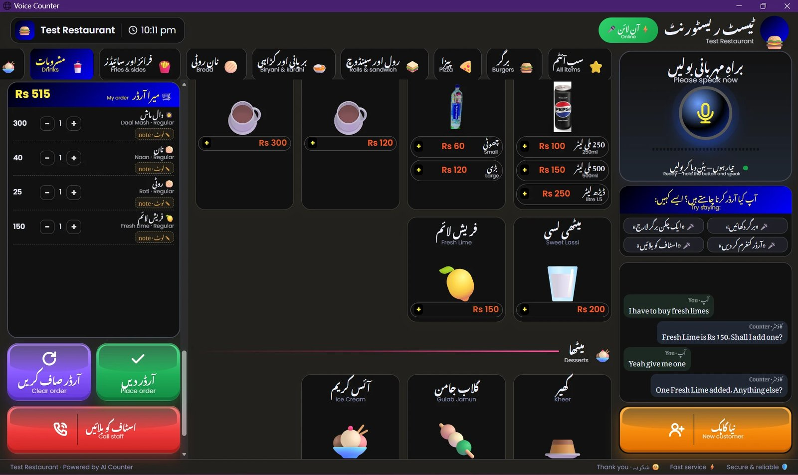
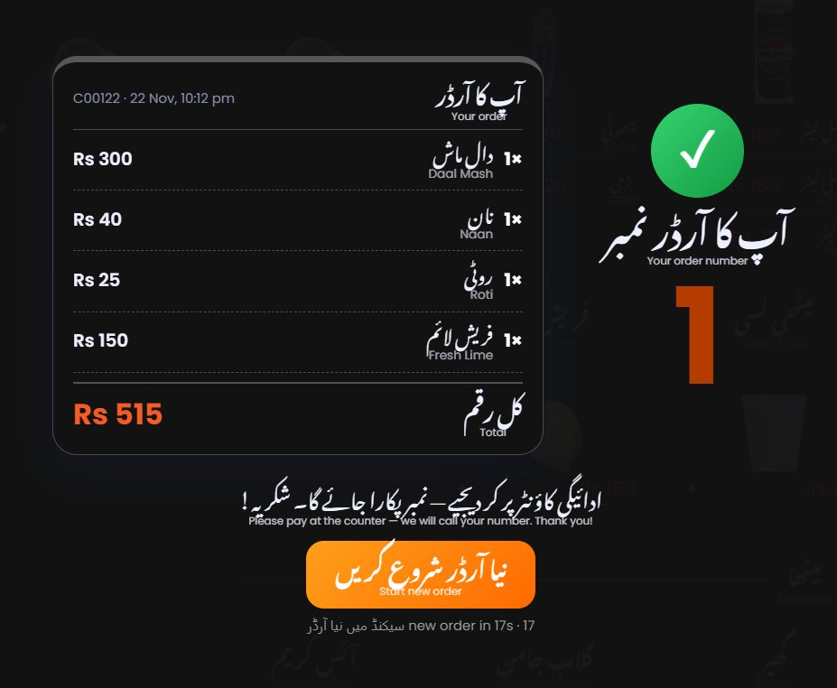
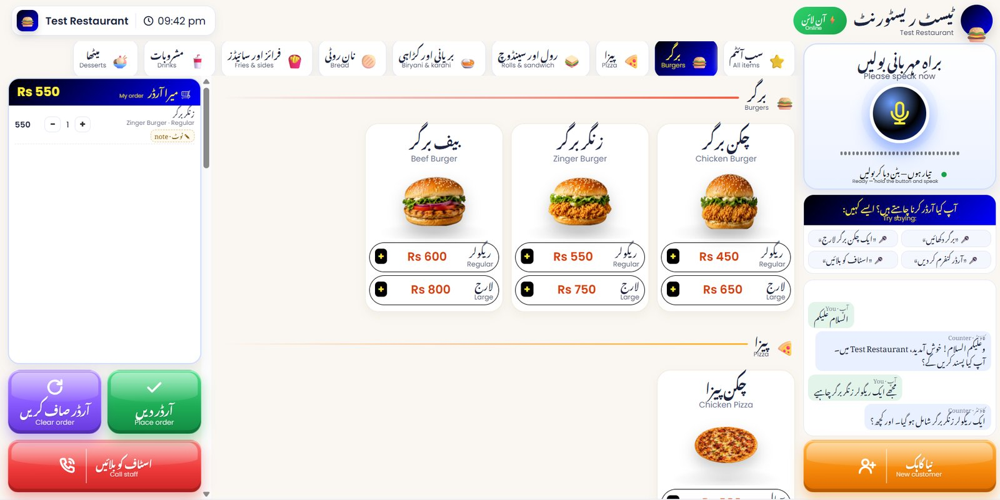
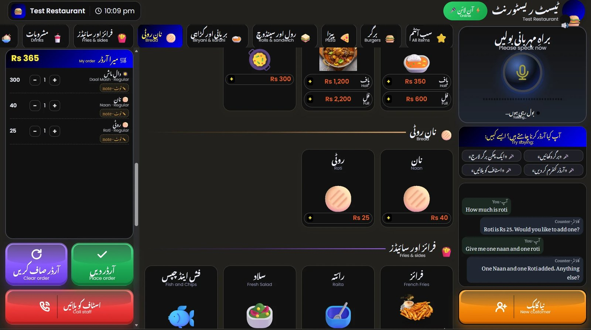

# Voice Counter Agent 🎙️🤖

**A voice "counter man" for shops and restaurants.** Customers speak their order in Urdu or English, an AI agent built on **Anthropic Claude** takes the order, and the confirmed receipt appears on the counter screen.

Designed and built by **Iftikhar Ahmed** with Claude Code (2026).

> This is a showcase. The source code is private. A live demo or code walkthrough is available on request.

   
  <em>The counter screen: the customer asks in English, the agent answers and adds Fresh Lime. The order list is on the left.</em>

---

## What it does

1. The customer presses one big button and speaks their order.
2. The system turns the voice into text with **my own fine-tuned Urdu speech model**.
3. A **Claude agent** understands the order, checks products and prices in the shop's database, and reads the order back.
4. The customer confirms. The order is **locked**, and the receipt appears on screen with an order number.
5. The reply is spoken back in Urdu.

**Safety by design:** prices always come from the shop's database, never from the AI, and an order is locked only after the customer confirms.

## Results

| What | Result |
|---|---|
| Speech recognition accuracy (real counter voice tests) | **95.1 %** |
| Time to understand one sentence (laptop) | **0.25 seconds** |
| Languages | Urdu, English, and both mixed in one sentence |
| Shops | One system serves many shops, each with its own menu |

## Screens (test shop with a made-up menu)

   
  <em>Order confirmed: receipt with items, total and order number. "Please pay at the counter."</em>

   
  <em>Light theme: a conversation in Urdu. The customer is greeted, then a Regular Zinger Burger is added.</em>

   
  <em>The customer asks the price of roti, then orders one naan and one roti. The order list updates at once.</em>

## How it fits together

1. **Counter screen** (tablet or laptop): the customer speaks.
2. **Speech to text**: my own fine-tuned Urdu speech model.
3. **Claude agent**: understands the order and builds it.
4. **Shop system**: menu, prices and orders for each shop.
5. **Receipt and spoken reply**: shown and spoken at the counter.

## Main parts of the system

| Part | What it does |
|---|---|
| Ordering agent | Claude takes and confirms the order |
| Shop system | Menus, prices and orders for many shops |
| Voice service | Listening, speaking and the counter screen |
| Speech model | Training and testing of the Urdu speech model |
| Admin and shop panels | Web pages for the owner and shopkeeper |
| Server setup | Runs on a Linux server |
| Tests | Checks for orders and receipts |

## Built with

Anthropic Claude · Claude Code · n8n · Python · PHP · MariaDB · Whisper + LoRA fine-tuning · OpenVINO · Piper text-to-speech · Docker · HTML/JavaScript

## Status

Working prototype, tested with made-up shops. Next: order-slip printing, a kitchen screen, and a pilot in a real shop.

---

**Contact:** iftikhar.ahmed.job1@gmail.com · [GitHub profile](https://github.com/iftikhar-ahmed-ai)

© 2026 Iftikhar Ahmed. All rights reserved.
